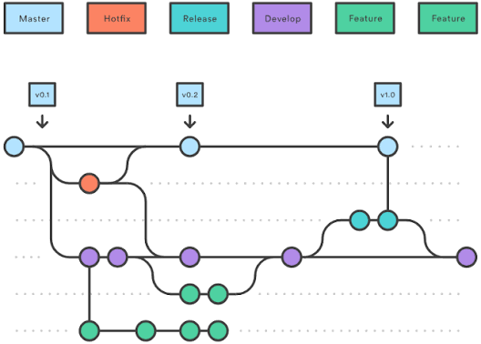

# FIV | F1TENTH Team Four @ UCSB
## Overview
This is the system overview.

## System Diagram

## GitHub Flow
Based on the typical flow, except with a tiny caveat: given that we have divided tasks by 2 (so 2 people per task/deliverable), we can be more lax in the branching for feature/dev, HOWEVER... master (main) and release (test) HAVE to be left alone until we all agree and work on it.

